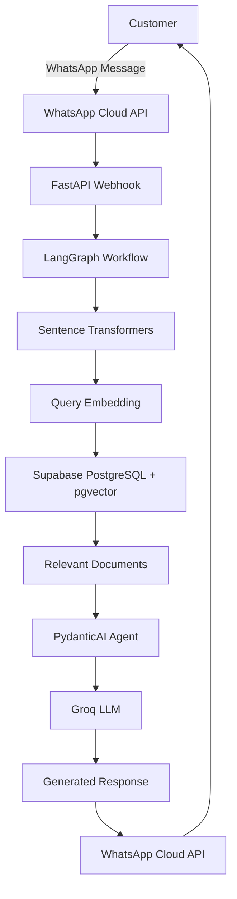

# WhatsApp AI Customer Support Chatbot

An AI-powered WhatsApp customer support chatbot built using **Retrieval-Augmented Generation (RAG)**. It helps users get technical support by retrieving relevant troubleshooting information from a structured knowledge base and generating contextual responses using an LLM.

The chatbot integrates the WhatsApp Cloud API with FastAPI, LangGraph, PydanticAI, Groq, and Supabase PostgreSQL with pgvector to deliver intelligent, context-aware customer support.

## Key Features

- **WhatsApp Integration:** Receive customer queries and send AI-generated responses through WhatsApp.
- **Retrieval-Augmented Generation (RAG):** Retrieve relevant technical information from a knowledge base before generating responses.
- **Semantic Search:** Find relevant support records using vector embeddings and similarity search.
- **AI-powered Responses:** Generate contextual answers using Groq LLM.
- **Technical Troubleshooting:** Provide structured, step-by-step troubleshooting guidance.
- **Priority-based Support:** Use issue priority information such as Low, Medium, High, and Critical.
- **AI Agent Workflow:** Manage the support conversation using LangGraph and PydanticAI.
- **Context-aware Conversations:** Maintain conversation history to support follow-up questions.
- **Human Escalation:** Allow unresolved or unsupported issues to be escalated to a human technician.

## Technology Stack

| Technology | Purpose |
|---|---|
| Python | Backend programming |
| FastAPI | Backend API and webhook handling |
| LangGraph | AI workflow orchestration |
| PydanticAI | AI agent development |
| Groq | LLM inference |
| Sentence Transformers | Text embeddings |
| Supabase | PostgreSQL database hosting |
| pgvector | Vector storage and similarity search |
| Meta WhatsApp Cloud API | WhatsApp messaging integration |
| Uvicorn | ASGI server |
| python-dotenv | Environment variable management |

## How It Works

The chatbot follows a RAG-based architecture:

1. **Customer Query:** A customer sends a technical support message through WhatsApp.
2. **Webhook:** WhatsApp Cloud API forwards the incoming message to the FastAPI webhook.
3. **Text Embedding:** The customer's query is converted into a numerical vector using Sentence Transformers.
4. **Vector Search:** Supabase PostgreSQL with pgvector searches for relevant records in the knowledge base.
5. **Context Retrieval:** The most relevant troubleshooting information is retrieved.
6. **AI Agent:** LangGraph and PydanticAI manage the workflow and pass the retrieved context to the Groq LLM.
7. **Response Generation:** The LLM generates a response based on the retrieved information.
8. **WhatsApp Response:** The generated response is sent back to the customer through the WhatsApp Cloud API.

## Architecture



## Sample Knowledge Base

This project uses a fictional sample CSV dataset containing technical support scenarios for three sample robot models.

### Sample Robot Models

- CareBot Alpha
- SecuriBot Prime
- ServiBot 5000

### Dataset Information

The dataset contains structured troubleshooting information, including:

- Robot model names
- Issue categories
- Incident summaries
- Detailed issue descriptions
- Issue priority levels
- Four troubleshooting steps for each incident

### Issue Categories

- POWER_SYSTEM
- TASK_EXECUTION
- SAFETY_SYSTEM
- NAVIGATION
- USER_INTERFACE
- COMMUNICATION
- HARDWARE
- SOFTWARE
- MAINTENANCE
- SENSOR_SYSTEM
- ENVIRONMENTAL_INTERACTION

### Dataset Columns

| Column | Description |
|---|---|
| ROBOT_MODEL | Name of the robot model |
| ISSUE_CATEGORY | Category of the technical issue |
| INCIDENT_SUMMARY | Short description of the problem |
| DESCRIPTION | Detailed incident description |
| PRIORITY | Issue severity |
| STEP_1 | First troubleshooting step |
| STEP_2 | Second troubleshooting step |
| STEP_3 | Third troubleshooting step |
| STEP_4 | Fourth troubleshooting step |

**Dataset Note:** All records are fictional sample data created for project development and demonstration. They do not represent actual company information or customer records.

## Project Structure

```text
whatsapp-ai-customer-support-agent/
│
├── agents/
│   └── assistant.py
│
├── api/
│   └── routes/
│       └── whatsapp.py
│
├── database/
│   └── pg_vector.py
│
├── data/
│   ├── data.csv
│   └── data_processor.py
│
├── graph_builder.py
├── main.py
│
├── requirements.txt
├── .env.example
├── .gitignore
└── README.md
```

*Note: This is the documented project layout. Update it if your actual repository structure differs.*

## Installation and Setup

### Prerequisites

Make sure you have the following:

- Python 3.10 or higher
- Git
- Groq API key
- Supabase account and PostgreSQL database
- Meta Developer account
- WhatsApp Cloud API credentials

### 1. Clone the Repository

```bash
git clone https://github.com/YOUR_USERNAME/whatsapp-ai-customer-support-agent.git
```

Navigate to the project directory:

```bash
cd whatsapp-ai-customer-support-agent
```

### 2. Create a Virtual Environment

```bash
python -m venv venv
```

Activate the environment on Windows:

```powershell
venv\Scripts\activate
```

### 3. Install Dependencies

```bash
pip install -r requirements.txt
```

### 4. Configure Environment Variables

Create a `.env` file in the root directory.

Use `.env.example` as a reference and configure your credentials:

```env
# Groq API
GROQ_API_KEY=

# Logfire (Optional)
LOGFIRE_TOKEN=

# Supabase Database
SUPABASE_DB_HOST=
SUPABASE_DB_PORT=5432
SUPABASE_DB_NAME=postgres
SUPABASE_DB_USER=
SUPABASE_DB_PASSWORD=

# WhatsApp Cloud API
WHATSAPP_API_TOKEN=
WHATSAPP_PHONE_NUMBER_ID=
WHATSAPP_VERIFY_TOKEN=
```

Add any additional environment variables required by your implementation.

**Important:** Never upload your actual `.env` file or expose API keys and database credentials.

### 5. Configure Supabase

1. Create a Supabase project.
2. Configure the PostgreSQL database connection.
3. Enable the pgvector extension.
4. Create the required vector table with the correct embedding dimension.
5. Configure the database credentials in your `.env` file.

### 6. Prepare the Knowledge Base

Place the sample CSV file in the `data/` directory.

Run your data-processing or ingestion script to:

- Read the CSV records.
- Process the technical support information.
- Generate text embeddings using Sentence Transformers.
- Store the embeddings and corresponding text in Supabase PostgreSQL.

Make sure the database vector dimension matches the embedding model used during ingestion and retrieval.

### 7. Configure WhatsApp Cloud API

1. Create an application in Meta for Developers.
2. Set up the WhatsApp product.
3. Configure the WhatsApp phone number.
4. Generate the required access token.
5. Configure the webhook callback URL and verification token.
6. Subscribe to the required WhatsApp message webhook events.

For local webhook testing, expose your FastAPI server through a tunneling service such as ngrok and configure the resulting HTTPS URL in Meta Developer settings.

### 8. Run the Application

Start the FastAPI application:

```bash
uvicorn main:app --reload
```

The application will run at:

```text
http://127.0.0.1:8000
```

FastAPI interactive API documentation:

```text
http://127.0.0.1:8000/docs
```

## Environment Configuration

| Variable | Description |
|---|---|
| GROQ_API_KEY | API key for Groq |
| LOGFIRE_TOKEN | Optional Logfire monitoring token |
| SUPABASE_DB_HOST | Supabase PostgreSQL host |
| SUPABASE_DB_PORT | PostgreSQL port |
| SUPABASE_DB_NAME | Database name |
| SUPABASE_DB_USER | Database username |
| SUPABASE_DB_PASSWORD | Database password |
| WHATSAPP_API_TOKEN | WhatsApp access token |
| WHATSAPP_PHONE_NUMBER_ID | WhatsApp phone number ID |
| WHATSAPP_VERIFY_TOKEN | Custom webhook verification token |

## Future Enhancements

- Multilingual WhatsApp customer support.
- Improved semantic retrieval and relevance filtering.
- Advanced conversation memory.
- Human technician support dashboard.
- Customer query analytics and reporting.
- Improved error handling and monitoring.
- Support for additional document formats such as PDF and DOCX.

## Author

**Prasad Shankar Kale**

AI / Generative AI Developer

GitHub: [Your GitHub Profile](https://github.com/prasadkale59277)

---

**Project Focus:** Generative AI | Retrieval-Augmented Generation (RAG) | AI Agents | Vector Databases | WhatsApp Automation

*Built to demonstrate how Large Language Models, semantic search, and AI agents can be integrated into a practical WhatsApp-based customer support application.*
